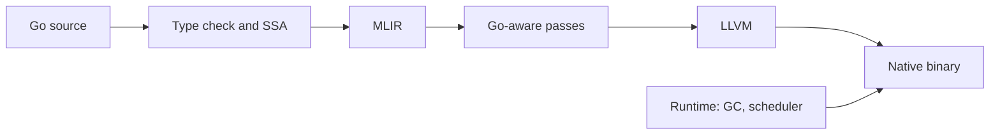

# marmot

A Go compiler built on MLIR and LLVM. Keep your Go code, switch the compiler, and get small
native executables.

```sh
marmot build ./cmd/app             # fast rebuilds
marmot build -release ./cmd/app    # whole program optimization
marmot run main.go
marmot test ./...
```

Status: experimental. marmot compiles real Go programs, including itself, but it is new and not
ready for production use.

## At a glance

Measured against `go build` on an Apple M3 Pro, default flags. Every program's output is checked
against Go. These are early numbers; see [docs/benchmarks.md](docs/benchmarks.md).

| | marmot | go |
| --- | --- | --- |
| hello world binary | 148 KB | 1.68 MB |
| run time, average over 43 programs | 1.6x faster | 1.0 |
| rebuild when nothing changed | about equal | |
| rebuild of a large program after a small edit | about 4x slower | |



## Documentation

- [Usage](docs/usage.md): commands, flags, build modes.
- [Design](docs/design.md): how the compiler and runtime are put together.
- [Benchmarks](docs/benchmarks.md): speed, size and build time, with the method.
- [Support](docs/support.md): what works, what does not, and known differences from Go.

## Building from source

Needs Go 1.27, LLVM and MLIR 22, CMake and Ninja.

```sh
make
make test
```

The name: a marmot is a close relative of the gopher, and it starts with M, like MLIR.
