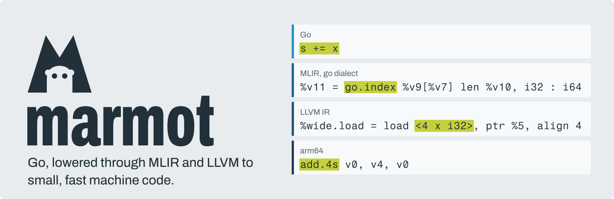
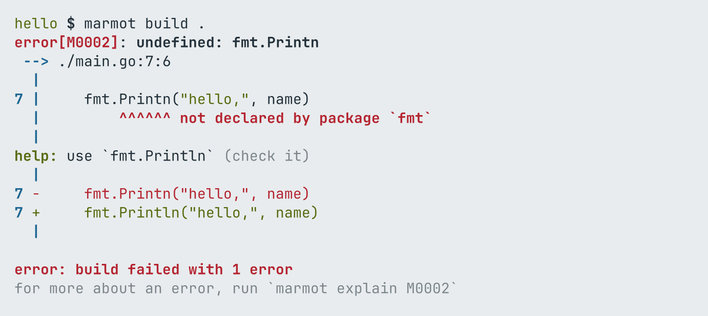
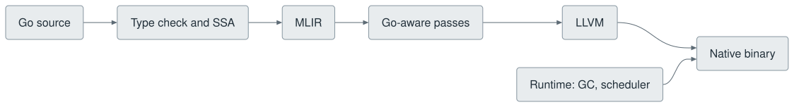

<picture>
  <source media="(prefers-color-scheme: dark)" srcset="docs/img/brand/banner-dark.svg">
  
</picture>

A Go compiler built on MLIR and LLVM. Keep your Go code and your `go.mod`, switch the compiler,
and get small, fast native binaries and errors that show you the fix.

**Status:** experimental. marmot compiles real Go programs, including itself, and checks every
test program's output against Go, but it is new and not ready for production use.

## Quick start

marmot is built from source for now. It needs Go 1.27, LLVM and MLIR 22, CMake and Ninja, on
macOS on Apple Silicon or Linux on x86-64.

```sh
git clone https://github.com/Gaurav-Gosain/marmot && cd marmot
make && make install           # installs to ~/.marmot, links ~/.local/bin/marmot
marmot doctor                  # checks the installation
```

Then, inside any Go module:

```sh
marmot run main.go
marmot build ./cmd/app             # dev build: fast rebuilds
marmot build -release ./cmd/app    # whole program optimization
marmot test ./...
```

## Against go build

Measured on an Apple M3 Pro on 2026-11-13, newest measurement of each. Every program's output is
checked against Go. Method and every number: [docs/benchmarks.md](docs/benchmarks.md).

| | marmot | go |
| --- | --- | --- |
| hello world with `println`, `-release` | **148 KB** | 1.68 MB |
| hello world with `fmt.Println`, `-release` | **665 KB** | 2.4 MB |
| run time, geometric mean of 43 programs, `-release` | **1.6x faster** | 1.0x |
| first build of `cmd/marmot` (238 packages), empty caches | **5.13 to 5.43 s** | 5.23 to 6.34 s |
| rebuild, nothing changed | **0.05 to 0.07 s** | 0.14 to 0.15 s |
| rebuild after a one line edit in the main package | 0.68 to 0.70 s | **0.50 to 0.51 s** |
| rebuild after a one line edit in a deep package | 0.94 to 0.96 s | **0.90 to 0.93 s** |

Of the 43 programs, 33 are faster than with Go and 10 slower: allocation heavy code and `defer`
in hot loops are where Go still wins.

## What you get

Errors show the source, the exact span, a label on every place involved, and a fix that
`marmot fix` can apply. Off a terminal they are the plain lines the go tool prints; under a
coding agent they are JSON, with the fixes as edits. Every error has a stable code that
`marmot explain` describes.

<picture>
  <source media="(prefers-color-scheme: dark)" srcset="docs/img/shot-error-short-dark.png">
  
</picture>

One command does what people usually install next to `go`:

| Command | What it does |
| --- | --- |
| `build`, `run`, `test` | Like the go command. Test failures are shown at their line. |
| `check` | fmt, vet, lint, gopls, vuln, tidy, cross builds, nil checks and dead code in one cached pass. |
| `fix` | Applies the suggested fixes of errors and findings, and keeps only what still builds. |
| `fmt` | gofmt and goimports. |
| `watch` | Builds, runs or tests again on every save. |
| `repl` | Go expressions and statements, as you type. |
| `bench`, `prof`, `size` | Benchmarks against `go test` with significance, pprof in the terminal, what a binary is made of. |
| `generate` | `//go:generate`, with each directive's outputs cached. |
| `bind` | Go bindings from a C header. |
| `mcp` | build, run, test, fix, check and explain for coding agents. |
| `explain`, `doctor` | What an error code means; what to fix in the installation. |

**cgo.** Packages that `import "C"` build unchanged. A C call is a direct native call on the
goroutine's stack: an empty C function costs 2.3 ns, against 33 to 57 ns with go's cgo (Linux
on x86-64, `-release`). Release builds optimize the C and the Go together.

**Checks.** `marmot check` runs a project's CI checks in one process over one package graph, and
caches results per package. On a workspace of 10 modules and 204 packages the full set takes
46 s from an empty cache (251 s for the same tools run one by one) and 0.7 s when nothing
changed.

## How it works

<picture>
  <source media="(prefers-color-scheme: dark)" srcset="docs/img/overview-dark.svg">
  
</picture>

marmot keeps the parts of the Go toolchain that define the language: the `go/types` checker,
the SSA builder and Go's own standard library source. It replaces the parts that generate
code. A small `go` dialect keeps Go's meaning in MLIR long enough to remove bounds checks, keep
objects on the stack and call interface methods directly.

Dev builds use a fast code generator, then compile the same packages again with LLVM on idle
cores so later builds link optimized objects; the incremental front end compiles only changed
packages and their importers. Release builds optimize the whole program at once.

## Documentation

- [Usage](docs/usage.md): every command and flag, build modes, cgo and bindings, checks, error output.
- [Design](docs/design.md): how the compiler and the runtime are put together.
- [Benchmarks](docs/benchmarks.md): speed, size and build time, with the method.
- [Support](docs/support.md): platforms, what works, and known differences from Go.

The name: a marmot is a close relative of the gopher, and it starts with M, like MLIR.
