# Benchmarks

All numbers compare marmot with `go build` (Go 1.27) on the same machine. A program counts
only if its output is identical to Go's. Each result is the median of five runs after one
warm-up run.

These are early numbers from a young compiler. They will change.

## Run time

Apple M3 Pro, 43 programs.

| Build | Average speed against Go |
| --- | --- |
| `marmot build` (dev, fast code generator) | not measured yet |
| `marmot build` (dev, `MARMOT_TIER0=0`) | 1.4x faster |
| `marmot build -release` | 1.6x faster |

"Average" is the geometric mean. 33 of the 43 programs are faster than Go in release mode and
10 are slower.

An 8-core Intel desktop running Linux gives a similar picture: 1.6x faster on average over 45
programs.

### By kind of program

<picture>
  <source media="(prefers-color-scheme: dark)" srcset="img/speed-dark.svg">
  
</picture>

| Program | What it stresses | Against Go |
| --- | --- | --- |
| convolution | numeric loops | 17.8x faster |
| bit tricks | integer operations | 10.1x faster |
| sum, min, max | simple loops over slices | 8.9x faster |
| struct copy | copying values | 4.6x faster |
| interface calls | method calls through interfaces | 3.5x faster |
| string search | finding substrings | 2.8x faster |
| closures | calling function values | 2.0x faster |
| channel ping-pong | goroutine hand-off | 1.5x faster |
| quicksort | branches and swaps | about equal |
| tree building | allocation and garbage collection | 0.9x (slower) |
| defer in a loop | `defer` cost | 0.7x (slower) |

Where marmot wins big, the cause is usually vector instructions that Go's compiler does not
emit. Where it loses, the cause is allocation and `defer`, which Go has tuned for years.

### Loops that can run in parallel

marmot can prove that the iterations of some loops do not depend on each other, and then run
them on all cores. This is off by default while it is being reviewed. With it on:

| Program | Against Go |
| --- | --- |
| matrix multiply | 36x faster |
| mandelbrot | 17x faster |
| spectral norm | 17x faster |
| matrix transpose | 12x faster |

These use every core, so they are faster in wall-clock time, not in total CPU work.

<picture>
  <source media="(prefers-color-scheme: dark)" srcset="img/parallel-dark.svg">
  
</picture>

## Binary size

| Program | marmot | go |
| --- | --- | --- |
| hello world with `println` | 148 KB | 1.68 MB |
| hello world with `fmt.Println` | 665 KB | 2.4 MB |
| hello world, smallest settings (`-O z`) | 100 KB | 1.17 MB (stripped) |
| small program using `fmt`, `sort`, `strings`, a map | 500 KB | 1.62 MB (stripped) |

## Build time

Building the compiler itself (`./cmd/marmot`, 325 packages including the standard library) on an
Apple M3 Pro with 11 cores, measured on 2026-11-14 with default settings, two runs of each
compiler, alternating. The first build starts with empty caches on both sides. The edits add one
line to a function body: "leaf" is the main package, "deep" is a package that most of the
compiler uses.

| Case | marmot | go |
| --- | --- | --- |
| First build, empty caches | 4.40 to 4.57 s | 6.14 to 6.18 s |
| Rebuild, nothing changed | 0.05 s | 0.15 s |
| One line edit, leaf package | 0.59 s | 0.66 to 0.68 s |
| One line edit, deep package | 0.72 to 0.76 s | 1.18 to 1.23 s |

Dev builds use a fast code generator that writes machine code directly, without LLVM
(`MARMOT_TIER0=0` turns it off). It is never used with
`-release`. Its code is not optimized; for fast binaries use `-release`.

The incremental front end (the default; `MARMOT_INCREMENTAL=0` turns it off) type checks and
compiles only the changed packages and the packages that import them.

## cgo calls

The cost of one call to an empty C function, Linux on x86-64, `-release`:

| | marmot | go |
| --- | --- | --- |
| call to an empty C function | 2.3 ns | 33 to 57 ns |

A marmot C call is a direct native call on the goroutine's own stack; see
[cgo](usage.md#cgo).

## Memory

On small programs marmot binaries use about half the memory of Go binaries at run time, mostly
because the runtime starts fewer things up front.

## How to reproduce

```sh
make
go run ./bench/cmd/bench -list        # see the programs
go run ./bench/cmd/bench              # run them
go run ./bench/report                 # write the report
```

Run benchmarks on an idle machine. Other work on the same machine changes the results a lot.
